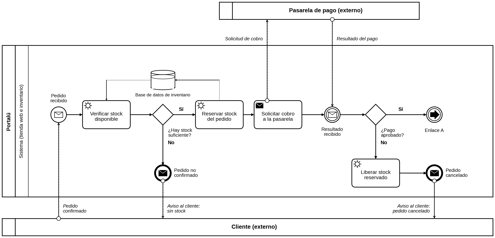
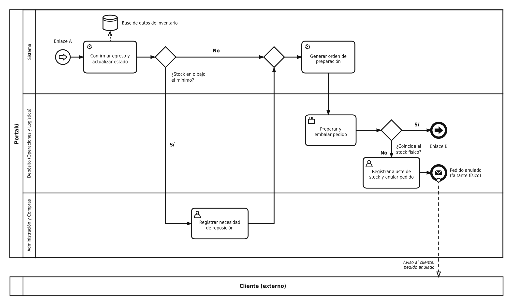
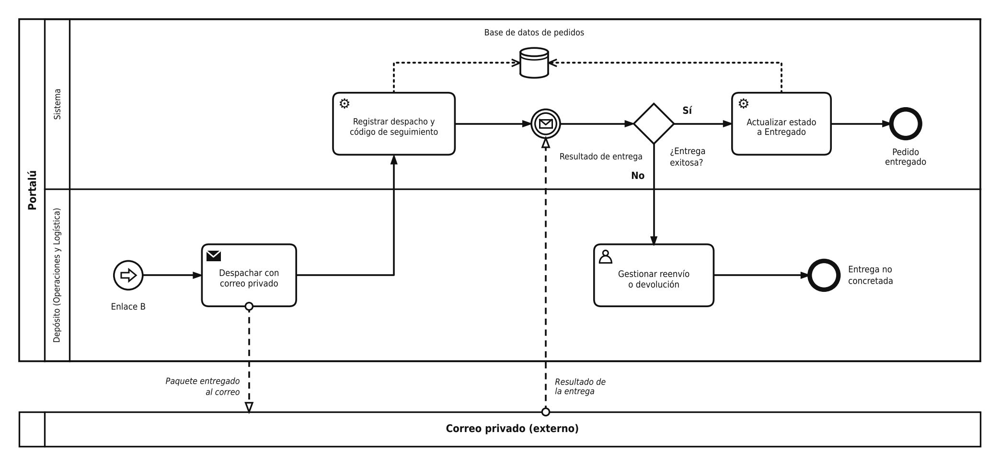
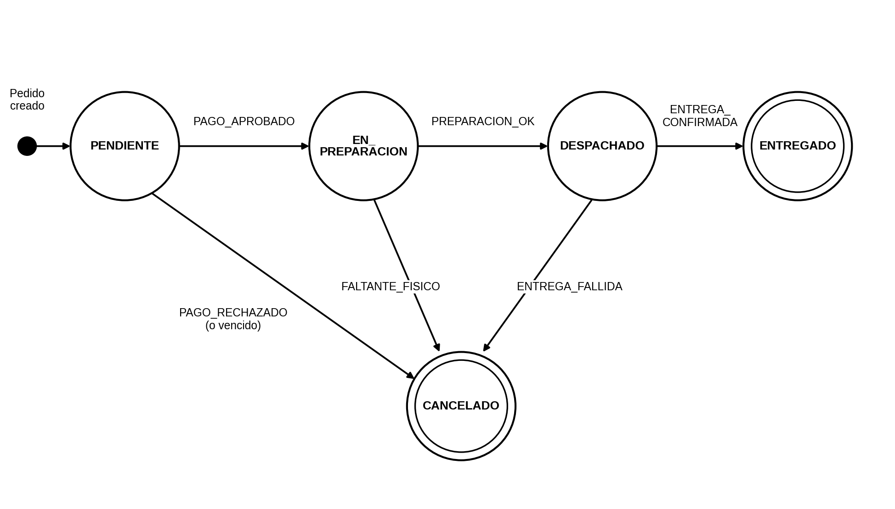
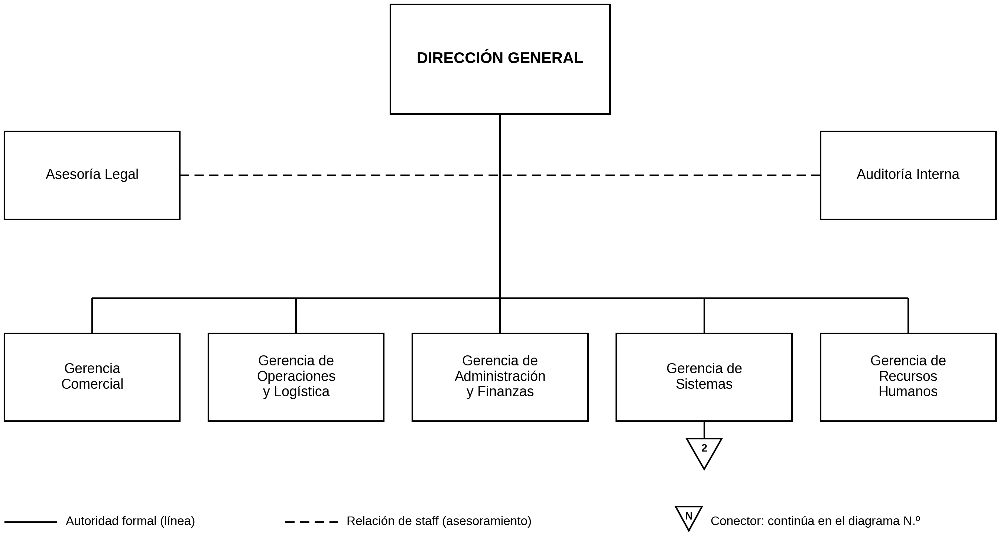

# Portalú · Sistema de Gestión de Inventario y Stock en Tiempo Real

Documentación técnica del Trabajo Práctico Integrador y Progresivo (TPI) de **Organización Empresarial** · Tecnicatura Universitaria en Programación a Distancia · Universidad Tecnológica Nacional.

## Descripción del sistema

Portalú es un comercio electrónico de indumentaria urbana. Su problema central es el desfasaje entre las prendas publicadas en la tienda web y las existencias reales del depósito, que provoca sobreventas y demoras. El **Sistema de Gestión de Inventario y Stock en Tiempo Real** se integra por API con la tienda para actualizar el stock en cada venta, emitir alertas de reabastecimiento cuando una prenda llega a su nivel mínimo, generar la orden de preparación de cada pedido y ofrecer reportes de rotación para las compras.

Este repositorio aloja el análisis, el diseño y el control del proyecto: modelo del sistema abierto, planeación, estructura formal, diccionario de datos, procesos en BPMN, estados del pedido, historias de usuario e indicadores.

## Integrantes

| Rol | Nombre |
|---|---|
| Autora | Kiara Calegari |
| Revisión de pares (Pull Request) | (completar con el nombre y el usuario de GitHub) |
| Docente titular | Carolina Bruno |
| Coordinadora de la materia | Gabriela Martínez |
| Docente tutor | Francisco Varberde |

## Enlaces

- **Tablero de gestión (GitHub Projects):** [TPI Portalú](https://github.com/users/kiara13408-blip/projects/2)

## Contenido

| Documento | Descripción |
|---|---|
| [`docs/entregas/`](docs/entregas) | Entregas N.º 1 (sistema abierto), 2 (planeación) y 3 (estructura formal y datos), en PDF. Las Entregas 1 y 2 se publican en su versión revisada. |
| [`docs/bpmn/`](docs/bpmn) | Proceso «Satisfacer el pedido de un cliente» en BPMN, en tres fases. |
| [`docs/estados/`](docs/estados) | Máquina de estados del pedido. |
| [`docs/organigramas/`](docs/organigramas) | Organigrama general y del Área de Sistemas. |
| [`docs/diccionario-de-datos.md`](docs/diccionario-de-datos.md) | Entidades, campos y relaciones. |
| [`docs/indicadores-de-control.md`](docs/indicadores-de-control.md) | Indicadores, estándares y auditoría técnica. |
| [`docs/backlog/historias-de-usuario.md`](docs/backlog/historias-de-usuario.md) | Historias de Usuario y criterios de aceptación. |

## Proceso modelado (BPMN)

El proceso se divide en tres fases enlazadas por los eventos A y B. Los pools externos son el Cliente, la Pasarela de pago y el Correo privado; los lanes internos son Sistema, Depósito y Administración y Compras.

**Notación de las líneas:**

- Línea continua con flecha rellena: flujo de secuencia dentro del proceso.
- Línea de trazos con círculo en el origen y flecha abierta: flujo de mensaje, es decir, comunicación con un pool externo.
- Línea de puntos con flecha abierta: asociación de datos, es decir, lectura o guardado de datos en una base de datos.

**Fase 1 · Confirmación del pedido y cobro**

**Fase 2 · Preparación del pedido**

**Fase 3 · Despacho y entrega**

## Estados del pedido

| Estado actual | Evento | Estado siguiente | Acción |
|---|---|---|---|
| PENDIENTE | PAGO_APROBADO | EN_PREPARACION | Confirmar egreso, evaluar el stock mínimo y generar la orden de preparación. |
| PENDIENTE | PAGO_RECHAZADO (o vencido) | CANCELADO | Liberar el stock reservado y avisar al cliente. |
| EN_PREPARACION | PREPARACION_OK | DESPACHADO | Despachar con el correo y registrar el código de seguimiento. |
| EN_PREPARACION | FALTANTE_FISICO | CANCELADO | Registrar el ajuste de stock, anular el pedido y avisar al cliente. |
| DESPACHADO | ENTREGA_CONFIRMADA | ENTREGADO | Actualizar el estado a Entregado. |
| DESPACHADO | ENTREGA_FALLIDA | CANCELADO | Gestionar reenvío o devolución; si se devuelve, reponer el stock. |

## Estructura formal

## Indicadores de control

| ID | Indicador y medición | Estándar | Fuente y responsable | Acción correctiva |
|---|---|---|---|---|
| K1 | Tiempo de sincronización: segundos entre la venta o el ingreso y la actualización del stock publicado (percentil 99). | ≤ 1,5 s en el 99% de las transacciones (Entrega 2, meta 1). | Registros del módulo; Gerencia de Sistemas. | Optimizar consultas y escalar el servicio en la nube. |
| K2 | Desfasaje de stock: unidades con diferencia entre sistema y conteo físico, sobre el total contado (%). | 0% en los primeros 60 días de producción (Entrega 2, meta 3). | Conteo cíclico contra Producto y Movimiento_Stock; Auditoría Interna. | Registrar el ajuste, investigar la causa y corregir el proceso. |
| K3 | Capacidad: SKU activos y solicitudes concurrentes de consulta sin degradación. | 10.000 SKU y 500 solicitudes concurrentes (Entrega 2, meta 2). | Pruebas de carga previas al despliegue; Especialista QA. | Ajustar la infraestructura y repetir la prueba. |
| K4 | Cumplimiento del cronograma: fases del Gantt terminadas en plazo sobre las planificadas (%). | 100% en 10 semanas (Entrega 2, meta 4). | Diagrama de Gantt; Líder de Proyecto. | Replanificar y reasignar recursos. |
| K5 | Faltantes físicos: pedidos anulados por faltante físico sobre pedidos confirmados (%). | 0% (propuesto; deriva de K2). | Pedido cancelado y Movimiento_Stock de ajuste; Operaciones y Logística. | Revisar la reserva y reforzar el control de recepción. |
| K6 | Tiempo de preparación: horas entre los estados En preparación y Despachado. | ≤ 24 h hábiles (propuesto). | Estados del Pedido; Operaciones y Logística. | Reasignar personal de depósito y revisar la orden de preparación. |

## Backlog

Las historias se gestionan en el tablero de GitHub Projects con las columnas **Por Hacer**, **En Progreso** y **Listo**. Detalle en [`docs/backlog/historias-de-usuario.md`](docs/backlog/historias-de-usuario.md).

| ID | Historia de Usuario | Criterios de aceptación | Estado |
|---|---|---|---|
| HU-01 | Como cliente de la tienda web, quiero ver la disponibilidad real de cada prenda por talle, para no comprar productos que no están disponibles. | El stock publicado se actualiza en ≤ 1,5 s (K1); el botón de compra se deshabilita con `stock_actual` = 0; no hay sobreventas (K5). | Listo |
| HU-02 | Como operario de depósito, quiero recibir una orden de preparación al confirmarse una venta y una alerta cuando una prenda llega a su stock mínimo, para reponer a tiempo y reducir los tiempos de empaque. | La orden se genera al pasar el pedido a En preparación; la alerta se emite con `stock_actual` ≤ `stock_minimo`; K6 ≤ 24 h hábiles. | En Progreso |
| HU-03 | Como responsable de compras, quiero acceder a reportes de las prendas de mayor rotación, para negociar con los proveedores según la demanda real y evitar stock inmovilizado. | El reporte se arma con `Detalle_Pedido` y `Movimiento_Stock` y ordena las prendas por unidades vendidas en un período. | Por Hacer |

## Flujo de trabajo en Git

- La rama `main` se mantiene estable: después de la carga inicial de la documentación, los cambios entran solo por Pull Request.
- Cada tarea tiene su rama (`docs/entregas-1-a-3`, `docs/bpmn-fase-1`, `docs/bpmn-fase-2`, `docs/bpmn-fase-3`, `docs/estados-del-pedido`, `docs/indicadores-de-control`, `docs/declaracion-ia`).
- Los commits siguen el formato `tipo: descripción en infinitivo`, por ejemplo `docs: agregar diagrama BPMN de confirmación y cobro`.
- El Pull Request de `docs/bpmn-fase-1` se revisa por pares con la lista de verificación de [`.github/PULL_REQUEST_TEMPLATE.md`](.github/PULL_REQUEST_TEMPLATE.md).

## Declaración de Uso de IA

### Asistentes utilizados

| Asistente | Uso |
|---|---|
| Gemini 3.6 Flash (Google) | Entrega N.º 2: texto base (FODA, objetivo, metas y tareas); la alumna armó el documento y las tablas. Entrega N.º 1: elección del caso de estudio, estructura y texto, que la alumna copió y ordenó en su documento; la versión exacta no se registró y, por la fecha, fue probablemente la misma. |
| Gemini 3.5 Flash-Lite High (Google) | Boceto inicial de la Entrega N.º 3 (organigrama y diccionario de datos). |
| ChatGPT (OpenAI) | Diagrama de bloques de la Entrega N.º 1, con su herramienta integrada de generación de imágenes, entre el 20 y el 30 de agosto de 2026. Por la fecha, el modelo fue probablemente GPT Image 2, aunque no pudo verificarse de manera retrospectiva. |
| Claude Sonnet 5.5 (Anthropic) | Reelaboración de la Entrega N.º 3 y estructura de la Entrega N.º 4: modelado del proceso, indicadores, estados del pedido y plan del repositorio. Revisión de las Entregas N.º 1 y 2 (formato, redacción, matriz FODA, diagrama de Gantt y diagrama de bloques) y nuevo dibujo de los diagramas BPMN con las líneas punteadas. |

Se conservan los registros de las conversaciones con los asistentes.

### Prompts y justificación crítica

| N.º | Asistente | Prompt (resumen) | Por qué se redactó así | Resultado y correcciones humanas |
|---|---|---|---|---|
| 1 | Gemini | Consulta sobre qué había que hacer en la Entrega N.º 1, con la consigna y la plantilla de la cátedra adjuntas; pedido de opciones de empresa y, luego, de completar la plantilla. | Se adjuntó el material de la cátedra para trabajar sobre los requisitos reales y, como la alumna no sabía qué empresa elegir, pidió alternativas simples de modelar. | Se eligió el comercio electrónico de indumentaria y la alumna cambió el nombre de la empresa a Portalú. Gemini adelantó un FODA que esta entrega no pedía y la alumna lo descartó. El texto traía mal cargados los datos de los docentes en la portada y un error de ortografía («despasajes»); ambos se corrigieron después. |
| 2 | ChatGPT | Pedido de un diagrama de bloques con el contenido del trabajo (entradas, procesos, salidas, retroalimentación, límites y ambiente) y, después, una versión con el nombre Portalú y una paleta de violeta y dorado. | La consigna exige un diagrama de bloques propio y Gemini solo dejó una nota para insertarlo; se usó una herramienta de imágenes para obtener una versión visual a partir del contenido ya redactado. | Se insertó la versión final con el nombre Portalú. El modelo de imágenes no pudo verificarse. En la versión revisada de la Entrega N.º 1, el diagrama se dibujó de nuevo con Claude. |
| 3 | Gemini | Pedido de completar la Entrega N.º 2 con la plantilla de la cátedra y, luego, de ajustar la declaración de IA para indicar el modelo utilizado, como había pedido el profesor. | Se pidió una base redactada de la consigna para acomodarla, y se precisó el modelo porque el profesor lo exigió en clase. | La alumna armó el documento y las tablas (la matriz FODA de 2×2 y el cronograma). Gemini sugirió declarar «Gemini 1.5 Pro»; la alumna lo corrigió, porque por la fecha de elaboración el modelo vigente era Gemini 3.6 Flash. Los datos de los docentes de la portada quedaron mal cargados y se corrigieron en la versión revisada. |
| 4 | Gemini | Pedido de una propuesta de organigrama y diccionario de datos a partir de las consignas y las entregas previas. | Se adjuntó el contexto real de Portalú para evitar ejemplos genéricos. | El boceto no incluía el organigrama dibujado, definía `monto_total` como Float, no vinculaba Pedido con Cliente y citaba una referencia que no pudo verificarse. |
| 5 | Claude | Ayuda con la tarea, con las entregas previas, la consigna y el boceto de Gemini: «quería ver qué podés hacer vos». | Se adjuntaron los documentos para que el asistente trabajara con el caso real y se pidió comparar con otra propuesta, para contrastar resultados. | Se agregaron Detalle_Pedido, Movimiento_Stock y stock_minimo, y se dibujaron los organigramas. La alumna corrigió con sus docentes la docente titular, el apellido del tutor y la versión de Gemini informada por la aplicación. |
| 6 | Claude | Consulta sobre incluir el material de la Unidad 4 en las referencias. | La decisión de citar la bibliografía de la cátedra dependía del criterio de la alumna. | Con el material aportado se rediseñaron los organigramas (rectángulos 2:1, conector, líneas de trazos) y se corrigieron las referencias. |
| 7 | Claude | Pedido de explicación de las decisiones de diseño. | Preparar la defensa oral y detectar debilidades. | Se declararon limitaciones: `monto_total` es un dato derivado y Producto no está totalmente normalizado. |
| 8 | Claude | Pedido de terminar la Entrega N.º 4, con la consigna, la plantilla y el material de BPMN, procesos, máquinas de estado y Git. | Se adjuntó todo el material de la cátedra para que el modelado siguiera sus reglas. | El asistente no tiene acceso a GitHub: el repositorio, las ramas, los commits, el Pull Request y el tablero fueron creados por la alumna, y el diagrama se contrastó con las reglas del material. |
| 9 | Claude | Pedido de mejorar las Entregas N.º 1 y 2 a partir de las devoluciones del tutor, con la Entrega N.º 3 como modelo de formato. | Las dos entregas se habían armado con texto de Gemini; se adjuntaron los documentos originales y las devoluciones para corregir la forma sin cambiar el contenido. | Se separó la portada del contenido y se corrigieron los datos de los docentes, el error de ortografía y el nombre de la AFIP, hoy ARCA. Se rediseñaron la matriz FODA, el diagrama de Gantt y el diagrama de bloques. Se verificó que las referencias bibliográficas de ambas entregas existen. El contenido conceptual se mantuvo y la alumna revisó los cambios. |
| 10 | Claude | Pedido de rehacer los tres diagramas BPMN con línea punteada en la comunicación entre pools y en el guardado de datos en una base de datos. | La devolución del tutor sobre la Entrega N.º 4 señaló ese error y la alumna marcó sobre capturas de pantalla cada línea que debía corregirse. | El asistente no tuvo acceso a los archivos originales de los diagramas, por lo que los redibujó a partir de las capturas. Los flujos de mensaje y las asociaciones con las bases de datos pasaron a línea punteada, y la alumna contrastó los diagramas nuevos con los anteriores. |

### Errores de los asistentes detectados

- En las declaraciones de las Entregas N.º 2 y 3, Gemini sugirió indicar «Gemini 1.5 Pro» como modelo utilizado, un dato que no coincidía con la realidad: se declaró Gemini 3.6 Flash en la Entrega 2 (según la fecha de elaboración) y Gemini 3.5 Flash-Lite High en la Entrega 3 (según la aplicación).
- El boceto de la Entrega N.º 3 incluía una referencia bibliográfica que no se pudo verificar.
- En las Entregas N.º 1 y 2, el texto de Gemini consignaba mal los datos de los docentes en la portada (la docente titular en la Entrega 1 y el tutor en ambas); el tutor lo señaló y se corrigió.
- El texto de la Entrega N.º 1, generado con Gemini, nombraba a la AFIP, organismo que fue reemplazado por la ARCA; se actualizó en la versión revisada.
- En la Entrega N.º 4, Claude sostuvo que los flujos de mensaje y las conexiones con la base de datos ya estaban en línea punteada; el tutor indicó lo contrario y la alumna marcó las líneas que faltaban, por lo que se redibujaron.
- Claude señaló como error el nombre de la docente titular de la Entrega N.º 2, pero era correcto; la alumna lo verificó con el tutor.
- Los primeros organigramas de Claude no cumplían las normas de la cátedra hasta que la alumna aportó el material de la Unidad 4.

### Responsabilidad intelectual

La alumna revisó, adaptó y validó el contenido, y asume la responsabilidad total sobre el trabajo, incluidos los posibles errores de los asistentes.

## Uso académico

Material elaborado con fines educativos para la cátedra Organización Empresarial (TUP · UTN). No está destinado a publicación comercial.
